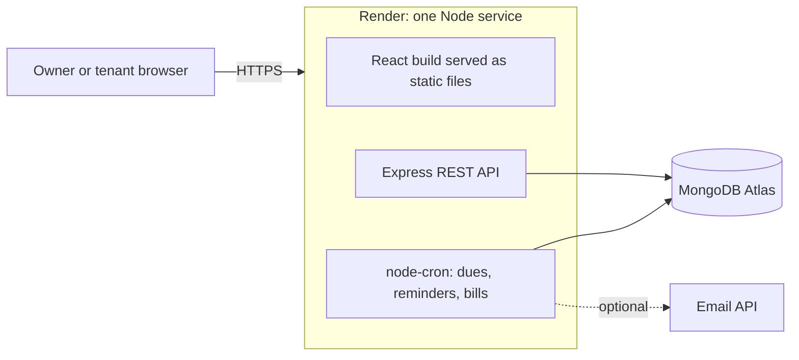

<div align="center">

# Nivaas

**A premium PG (paying-guest accommodation) management platform.**
Rent ledger, daily meal polls, leave credits, smart reminders and complaints, in one calm place.

[](https://nivaas-4ymc.onrender.com)


**[Live demo](https://nivaas-4ymc.onrender.com)** · **[Source](https://github.com/manvithknm54/nivaas)**

</div>

> The demo runs on a free hosting tier, so the **first load after a period of inactivity can take up to a minute** while the server wakes up. After that it is fast.

---

## Table of contents

1. [Why Nivaas exists](#why-nivaas-exists)
2. [Try it in two minutes](#try-it-in-two-minutes)
3. [Features](#features)
4. [Tech stack](#tech-stack)
5. [Architecture](#architecture)
6. [Engineering decisions](#engineering-decisions)
7. [Data model](#data-model)
8. [API overview](#api-overview)
9. [Running it locally](#running-it-locally)
10. [Testing](#testing)
11. [Deployment](#deployment)
12. [AI development experience](#ai-development-experience)
13. [Known limitations and roadmap](#known-limitations-and-roadmap)
14. [Author](#author)

---

## Why Nivaas exists

Nivaas is built around how a real PG is run, including the everyday friction:

- **Meals.** The owner posts a veg / non-veg poll in a WhatsApp group, counts the votes by hand, and tells the chef.
- **WiFi.** Nobody knows when the recharge expires, so tenants keep calling the owner to renew it.
- **Rent.** Dues, part-payments and "I'll pay next week" live in a notebook and in people's memories.
- **Going home.** When a tenant is away for a week, the rent reduction is negotiated ad hoc.

Nivaas replaces those with one system that has two roles: **owner** and **tenant**.

## Try it in two minutes

1. Open the [live demo](https://nivaas-4ymc.onrender.com) and choose **Create account → I own a PG**.
2. Create your PG. Three room types come pre-filled (bed in hall, room with shared bathroom, room with attached bathroom) and are editable in **Settings**.
3. Add a room under **Rooms**, then open **Tenants** to see the invite **QR code**. Use **Copy link**.
4. Open the copied link in a **private/incognito window** and register as a tenant. The tenant sends a join request.
5. Back as the owner, approve the request and assign a room. The tenant's menu (Rent, Meals, Leaves, Complaints) appears on its own within seconds.
6. Record a part-payment in **Rent**, vote in **Meals**, request a **Leave**, and raise a **Complaint**. The bell icon shows notifications for both sides.

## Features

### Owner
| Area | What it does |
|---|---|
| **Overview** | A "needs your attention" board: join requests, leave requests, extension requests, open complaints, bills about to expire, plus occupancy and this month's collection. |
| **Rooms and tenants** | Rooms with bed capacity and live occupancy. Invite tenants with a QR code or link, approve or reject requests, assign rooms (capacity is enforced), mark tenants as left. The QR can be reset, which invalidates the old one. |
| **Rent ledger** | Monthly dues generated automatically from each tenant's room type. Record part-payments, add credits or discounts, reverse mistakes (nothing is ever deleted). Month switcher, totals, overdue tracking, filters. Change a due date directly or approve a tenant's extension request. |
| **Meals** | Configurable special days (default: Wednesday egg, Sunday non-veg). Live veg / special counts, who has not voted, a **lock** button, and a **Copy for chef** message ready for WhatsApp. |
| **Leaves** | Approve or decline leave requests. The deduction is prorated from a weekly rate (default ₹250 per week) and posted to the rent ledger as a credit. Approved leaves can be cancelled, which reverses the credit. |
| **Bills and recharges** | Track the WiFi plan or any recurring recharge. Reminders start N days before expiry and repeat daily until it is marked renewed. |
| **Complaints** | Move complaints through open, in progress and resolved. Resolving **requires a note describing the work done**, which the tenant sees. |

### Tenant
| Area | What it does |
|---|---|
| **Join** | Scan the QR or open the invite link, create an account, wait for approval. Until approved, the tenant only sees a Home screen. |
| **Rent** | Dues, balance, full payment history, and a **Request more time** flow. |
| **Meals** | Vote veg or the day's special until the cutoff. If a tenant doesn't vote, their saved diet is used. |
| **Leaves** | Pick leave and return dates and see the estimated saving instantly. Cancel before it starts. |
| **Complaints** | Raise an issue, follow its status, and read what was done to fix it. |

### Platform
- **Smart reminders.** An hourly job reminds tenants about overdue rent about every 5 hours between 08:00 and 21:00 IST, starting on the due date and stopping as soon as it is paid or extended.
- **Notifications.** In-app bell for both roles. Email is optional (HTTPS email API or SMTP).
- **Polished UX.** Premium in-app dialogs instead of browser pop-ups, de-duplicated toasts, skeleton and empty states, an error boundary so a bug never produces a blank screen, responsive layout with a mobile bottom bar.
- **Safe by default.** Role-based access, per-PG data isolation, validated input, rate-limited login.

## Tech stack

| Layer | Technology |
|---|---|
| **Database** | MongoDB (Atlas) with Mongoose |
| **Backend** | Node.js 22, Express, Zod validation, JSON Web Tokens (httpOnly cookie), bcrypt, Helmet, express-rate-limit, node-cron, Nodemailer, `qrcode` |
| **Frontend** | React (Vite), React Router, TanStack Query, Axios, Tailwind CSS v4, Framer Motion, Lucide icons, react-hot-toast |
| **Testing** | Node's built-in test runner (`node --test`) |
| **Hosting** | Render (one web service), MongoDB Atlas free cluster |

## Architecture



In production a single Express service serves both the REST API under `/api` and the built React app. That keeps everything on one origin, which makes cookie auth simple and removes any CORS configuration.

```
nivaas/
├── client/                      React app (Vite)
│   └── src/
│       ├── api/                 axios instance, shared query hooks
│       ├── components/          ui/ (dialogs, modal, pills), layout/ (shell, bell), owner/
│       ├── context/             AuthContext
│       ├── lib/                 formatting and date helpers
│       ├── pages/               auth/, owner/, tenant/
│       └── routes/              ProtectedRoute
└── server/                      Express API
    └── src/
        ├── config/              database connection
        ├── controllers/         request handlers, one file per feature
        ├── jobs/                scheduler (dues, reminders, bills)
        ├── middleware/          auth, roles, requirePg, requireActive
        ├── models/              Mongoose schemas
        ├── routes/              route definitions per role
        ├── services/            business logic (ledger, leaves, meals, reminders, mail)
        └── utils/               ApiError, asyncHandler, IST date helpers
```

## Engineering decisions

These are the choices I would explain in a code review.

**1. Rent is an append-only ledger, not a "paid" flag.**
A due has an amount. Payments, credits and reversals are separate entries, and the balance is computed from them. Part-payments, discounts and corrections all work without editing history. A reversal entry is protected by a unique index so the same entry can only be reversed once.

**2. Monthly dues are idempotent.**
A unique index on `(tenant, month)` plus upserts means generation can run any number of times (the cron job, a tenant approval, the owner's button) without creating duplicates. A due also stores a snapshot of its amount, so changing fees later never rewrites past months.

**3. Leave credit is a ledger entry with its own lifecycle.**
Approval computes a prorated credit and applies it to the earliest open dues without ever pushing a balance below zero. Any remainder waits and is applied when the next due is generated. Cancelling a leave appends reversal entries rather than deleting anything.

**4. Business rules live on the server.**
Meal voting is validated server-side (poll must be open, the choice must be valid for that day, the tenant must not be on approved leave), and the UI is never trusted. Every query is scoped to the owner's PG or the tenant's own id, so one PG can never read another's data.

**5. The reminder job is restart-safe.**
It runs hourly and also at startup. Each due stores `lastReminderAt`, and a 4.5-hour gap inside the 08:00 to 21:00 IST window produces roughly three reminders a day. A restart or a missed hour cannot double-send. Reminder notifications are updated in place (keyed per due), so a reminder every few hours doesn't bury the bell.

**6. Failure modes are handled on purpose.**
Notifications never throw into the calling request. The server refuses to start with a clear message if required environment variables are missing. The React app has a route-level error boundary and every tenant page has an error state. Session state is only cleared on a real `401`, so a transient network error doesn't log anyone out.

**7. Polling over WebSockets.**
Screens refresh every 10 to 20 seconds with TanStack Query. For a PG of a few dozen people that is simple and reliable. Server-Sent Events would be the natural upgrade.

## Data model

| Collection | Purpose |
|---|---|
| `User` | Owner or tenant, diet, room, and join status (`unassigned`, `pending`, `active`, `left`) |
| `Pg` | PG settings: room-type fees, leave rate, rent due day, meal days and cutoff, invite token |
| `Room` | Room number, type, bed count |
| `RentDue` | One per tenant per month, with an amount snapshot, due date and optional extension |
| `RentEntry` | Ledger rows: `payment`, `credit` or `reversal` |
| `ExtensionRequest` | A tenant's request for more time on a due |
| `MealPoll` / `MealVote` | One poll per special day, one vote per tenant per poll |
| `LeaveRequest` | Dates, status, credit total and credit applied |
| `Bill` | Recurring recharges with expiry and renewal history |
| `Complaint` | Status, timeline and the resolution note |
| `Notification` | In-app notifications, optionally keyed for in-place updates |

## API overview

All routes are under `/api`. Owner and tenant routes require a valid session and the matching role.

| Area | Endpoints |
|---|---|
| **Auth** | `POST /auth/register`, `POST /auth/login`, `POST /auth/logout`, `GET /auth/me` |
| **Join** | `GET /join/:token`, `POST /join/:token` |
| **PG** (owner) | `POST/GET/PATCH /owner/pg`, `GET /owner/pg/invite`, `POST /owner/pg/invite/rotate`, `GET /owner/summary` |
| **Rooms, tenants** (owner) | `GET/POST /owner/rooms`, `DELETE /owner/rooms/:id`, `GET /owner/tenants`, `POST /owner/tenants/:id/(approve\|reject\|remove)` |
| **Rent** (owner) | `GET /owner/rent?month=`, `POST /owner/rent/generate`, `GET /owner/rent/:id`, `POST /owner/rent/:id/entries`, `POST /owner/rent/:id/extend`, `POST /owner/rent/entries/:id/reverse`, `GET /owner/extensions`, `POST /owner/extensions/:id/decide` |
| **Meals** (owner) | `GET /owner/meals`, `POST /owner/meals/:id/lock` |
| **Leaves** (owner) | `GET /owner/leaves`, `POST /owner/leaves/:id/(approve\|reject\|cancel)` |
| **Bills** (owner) | `GET/POST /owner/bills`, `POST /owner/bills/:id/renew`, `DELETE /owner/bills/:id` |
| **Complaints** (owner) | `GET /owner/complaints`, `POST /owner/complaints/:id/status` |
| **Tenant** | `GET /tenant/rent`, `POST /tenant/rent/:id/extension`, `GET /tenant/meals`, `POST /tenant/meals/:id/vote`, `PATCH /tenant/profile`, `GET/POST /tenant/leaves`, `POST /tenant/leaves/:id/cancel`, `GET/POST /tenant/complaints` |
| **Notifications** | `GET /notifications`, `POST /notifications/read`, `POST /notifications/:id/read` |
| **Health** | `GET /health` |

## Running it locally

**Prerequisites:** Node.js 20.19+ or 22, npm, and a MongoDB database (a free [Atlas](https://www.mongodb.com/atlas) cluster works).

```bash
git clone https://github.com/manvithknm54/nivaas.git
cd nivaas

# Backend
cd server
npm install
cp .env.example .env        # then fill in the values below
npm run dev                 # API on http://localhost:5000

# Frontend (new terminal)
cd client
npm install
npm run dev                 # app on http://localhost:5173 (proxies /api to the server)
```

**Environment variables** (`server/.env`):

| Variable | Required | Description |
|---|---|---|
| `MONGO_URI` | Yes | MongoDB connection string, including a database name |
| `JWT_SECRET` | Yes | Long random string used to sign session tokens |
| `CLIENT_URL` | Yes | Public URL of the app. QR codes and invite links are built from this. Locally: `http://localhost:5173` |
| `PORT` | No | Defaults to the platform's value. Locally `5000` |
| `NODE_ENV` | No | Set to `production` in deployment (enables secure cookies) |
| `SERVE_CLIENT` | No | `true` makes Express serve the built React app (used in production) |
| `BREVO_API_KEY`, `MAIL_FROM` | No | Send email through an HTTPS email API (works on hosts that block SMTP) |
| `SMTP_HOST`, `SMTP_PORT`, `SMTP_USER`, `SMTP_PASS` | No | Or send email over SMTP |

If no email settings are present, notifications work in-app only.

## Testing

```bash
cd server
npm test
```

Unit tests (Node's built-in runner) cover the logic where mistakes are expensive: ledger balance and status calculation, reversals, overdue rules, meal-poll counting and state transitions, and prorated leave credit.

Beyond unit tests, I tested the full flows by hand with an owner in one browser and tenants in private windows, including permission checks (a tenant opening owner URLs, and one owner requesting another owner's data). There are **no automated end-to-end or frontend tests yet**.

## Deployment

The live demo runs as **one Render web service** (Express serves the API and the built React app) backed by a **MongoDB Atlas** free cluster.

- **Build command:** `cd client && npm install --include=dev && npm run build && cd ../server && npm install`
- **Start command:** `cd server && npm start`
- **Environment:** `NODE_VERSION=22`, `NODE_ENV=production`, `SERVE_CLIENT=true`, `MONGO_URI`, `JWT_SECRET`, `CLIENT_URL`
- Pushing to `main` triggers a redeploy.

Free-tier notes: the instance sleeps when idle (first request can take about a minute), outbound SMTP is blocked (hence the HTTPS email option), and the free Atlas cluster has no automated backups.

## AI development experience

Being open about how this was built is part of the work, so this section is written to be specific and honest.

### Code0

**[FILL IN: Confirmation of Code0 use. State plainly what is true, e.g. which parts of development you used Code0 for, and how you used its Git workspace and terminal for commits and pushes. Do not claim more than you did.]**

**[FILL IN: 2 to 3 sentences on how Code0 fitted into your workflow, what it was good at, and where you did not trust it.]**

Specific tasks where Code0 helped:

| # | Task | What I asked | What Code0 produced | What I verified or changed |
|---|---|---|---|---|
| 1 | **[FILL IN]** | **[FILL IN]** | **[FILL IN]** | **[FILL IN: include anything it got wrong and how you fixed it]** |
| 2 | **[FILL IN]** | **[FILL IN]** | **[FILL IN]** | **[FILL IN]** |
| 3 | **[FILL IN]** | **[FILL IN]** | **[FILL IN]** | **[FILL IN]** |

### Other AI assistance

I also used **Claude (Anthropic)** in a chat interface as a pair-programmer: for discussing architecture and trade-offs, and for first drafts of a lot of the code. Nothing was accepted on trust. I ran the code locally and in production, tested it by hand, and drove the fixes for what broke. Examples of problems I found myself and had corrected:

- **Locked out by my own rate limiter.** Testing in two windows, I started getting `429` errors and being redirected to the login page. The cause was a blanket rate limit on `/auth/*`, which my polling was hitting, combined with a session refresh that treated *any* error as "logged out". The fix was to rate-limit only failed login and register attempts, and to clear the session only on a real `401`.
- **White screen for a tenant who hadn't joined a PG.** Opening Meals made the API correctly answer `403`, but the page dereferenced undefined data and crashed the whole app. The fix was status-based menus, route guards, error states on every tenant page and an error boundary.
- **Duplicate toasts.** Clicking "Generate dues" repeatedly stacked identical notifications. The fix was a fixed toast id plus a global limiter.
- **Production deployment failures.** An Atlas authentication error and a missing `JWT_SECRET`, which surfaced as a vague "Something went wrong". I read the server logs to find the root causes, then added a fail-fast environment check so a missing setting names itself.

## Known limitations and roadmap

- Rent is not prorated for tenants who join mid-month; the owner can add a credit manually.
- The "overpay" check on a payment could in theory race with a simultaneous request. A MongoDB transaction would close it.
- Returning early from a leave isn't supported yet (cancel and re-file instead).
- Two simultaneous approvals for one tenant could in theory double-apply a leave credit.
- Complaints have no photo attachments yet. Pre-signed S3 uploads (as in my earlier serverless project) are the planned approach.
- Polling instead of WebSockets or Server-Sent Events.
- No automated frontend or end-to-end tests yet.
- Free hosting means cold starts and a database without automated backups.
- Planned: WhatsApp/push reminders, mid-month proration, per-tenant rent history export, multi-PG support for one owner.

## Author

**Manvith Kumar N M**, Information Science Engineering, NMIT Bengaluru.

[GitHub](https://github.com/manvithknm54) · [LinkedIn](https://linkedin.com/in/manvith-kumar-n-m-b5a955363)
